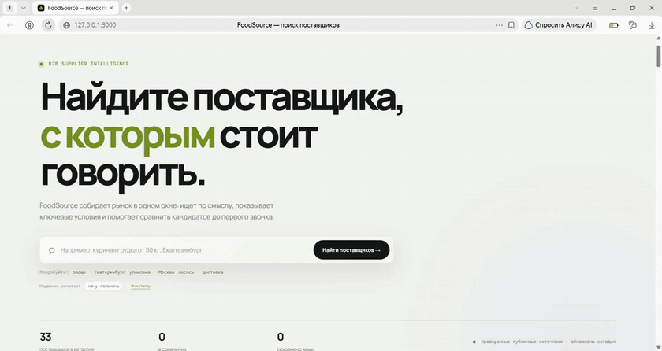
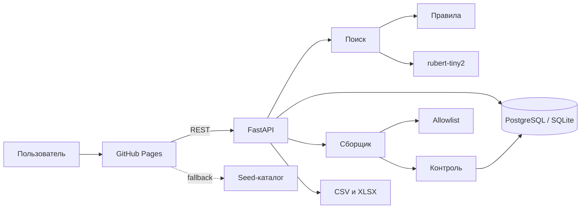
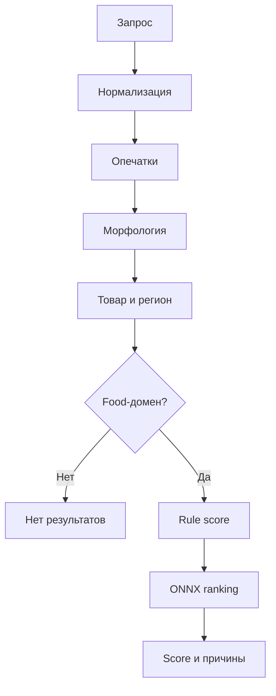
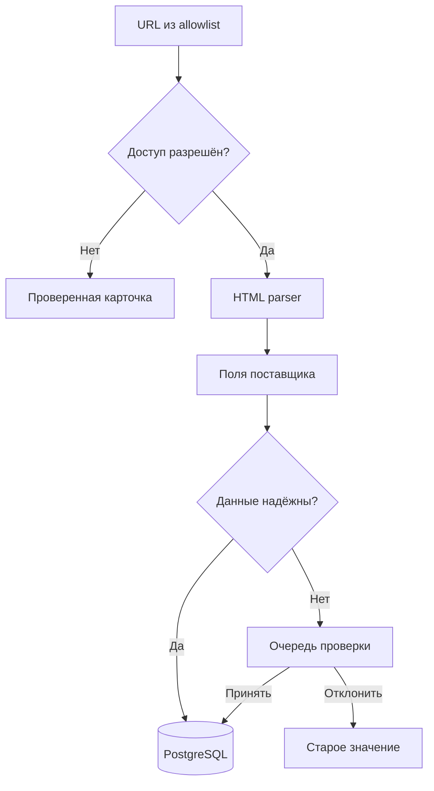

<p align="center">
  
</p>

<h1 align="center">FoodSource</h1>

<p align="center">
  Сервис поиска и сравнения поставщиков продуктов питания<br>
  с автоматическим сбором данных и объяснимым AI-ранжированием.
</p>

<p align="center">
  <a href="https://seniordanilbodrov.github.io/foodsource/"></a>
  <a href="https://foodsource-api.onrender.com/docs"></a>
  <a href="https://foodsource-api.onrender.com/api/search/status"></a>
</p>

<p align="center">
  
  
  
  
</p>

---

## Задача

Проект выполнен как вторая часть тестового задания. Требовалось создать сервис, который помогает пользователю:

- искать поставщиков по категории товара и региону;
- собирать ключевую информацию о компаниях;
- видеть контакты, сайт и источник данных;
- сравнивать условия и принимать решение, с кем связаться;
- учитывать минимальный заказ, цены, документы, доставку и заметки.

FoodSource превращает это в законченный закупочный сценарий: **описать потребность → получить объяснимую выдачу → проверить данные → сравнить кандидатов → сохранить следующий шаг → связаться**.

## Демо

**Frontend:** [seniordanilbodrov.github.io/foodsource](https://seniordanilbodrov.github.io/foodsource/)

**REST API:** [foodsource-api.onrender.com/docs](https://foodsource-api.onrender.com/docs)

**Статус AI-поиска:** [/api/search/status](https://foodsource-api.onrender.com/api/search/status)

> Бесплатный Render может запускаться после периода бездействия. Первый запрос иногда занимает больше времени, следующие выполняются быстрее.

<p align="center">
  
</p>

### Что попробовать

| Запрос | Ожидаемое поведение |
|---|---|
| `персики` | только поставщики овощей и фруктов, без упаковочных компаний |
| `пельмени и варенники` | исправление опечатки и релевантные поставщики полуфабрикатов |
| `одноразовая посуда` | поставщики упаковки и профессиональной посуды |
| `яблоки от 50 кг, Екатеринбург` | товар, регион и минимальная партия учитываются вместе |
| `ноутбуки` | пустая выдача: сервис не придумывает нерелевантных поставщиков |

## Результат

- 60 реальных поставщиков из проверенного allowlist;
- гибридный поиск: правила + морфология + опечатки + `rubert-tiny2-int8`;
- объяснение причин попадания каждой карточки в выдачу;
- последний полный прогон: 53 источника обработаны автоматически из 60, 8 записей требуют внимания (включая одну отложенную проверку изменений);
- источники с `robots.txt` или временной ошибкой сохраняются как проверенные карточки и явно попадают в отчёт качества;
- фильтры по категории, региону, типу, доставке, документам, минимальному заказу и контактам;
- сравнение 2–4 поставщиков;
- избранное, заметки и этапы работы с поставщиком;
- импорт CSV/XLSX и экспорт выборки в XLSX;
- отдельный экран качества и ручная проверка сомнительных обновлений;
- адаптивный интерфейс для desktop и mobile;
- PostgreSQL в облаке и SQLite как локальный fallback;
- ежедневное автообновление через GitHub Actions;
- 35 автоматических тестов поиска, парсинга, дедупликации, качества данных и XLSX.

## Соответствие ТЗ работодателя

| Требование | Реализация в FoodSource |
|---|---|
| Искать по категории товара | свободный запрос, словарь категорий и отдельный фильтр |
| Учитывать город или регион | извлечение региона из запроса и фильтрация каталога |
| Собирать информацию о поставщиках | allowlist-парсер публичных страниц + импорт оператора |
| Показывать контакты и источник | раздельные `phone`, `email`, `address`, сайт и прямая ссылка на источник |
| Помогать выбрать поставщика | explainable score, сравнение, избранное, статусы и заметки |
| Минимальный заказ и цена | отдельные поля, фильтр наличия минимального заказа |
| Документы и сертификаты | отдельный список и фильтр наличия документов |
| Условия доставки и регион работы | структурированные поля в карточке и сравнении |
| Практическая применимость | FastAPI, PostgreSQL/SQLite, XLSX, ежедневное автообновление и публичный deploy |
| Ссылка на прототип и репозиторий | live-demo и исходный код доступны публично |

## Пользовательский сценарий

1. Пользователь описывает закупку обычным языком.
2. Сервис распознаёт товар, категорию, регион, доставку и минимальную партию.
3. Строгие правила формируют безопасный набор кандидатов.
4. ONNX-модель внутри FastAPI переранжирует кандидатов по смыслу запроса.
5. Пользователь видит причины совпадения и качество данных.
6. Подходящие компании попадают в сравнение или избранное.
7. Статус `Новый → Проверить → К контакту → Отобран` сохраняется в PostgreSQL (локально — SQLite).
8. Итоговую выборку можно выгрузить в XLSX.

## Архитектура



Frontend и backend развёрнуты раздельно. Статический интерфейс остаётся доступным даже при холодном запуске API, а сервер отвечает за постоянное состояние, парсинг, AI-поиск и работу с файлами.

## Как работает поиск



### Почему не большая LLM

Модель не генерирует компании и факты. Она используется только как ранжировщик уже проверенных карточек. Такой подход:

- не создаёт вымышленных поставщиков;
- не пропускает карточку через ограничение категории;
- работает внутри FastAPI без внешнего AI API;
- остаётся быстрым и объяснимым;
- автоматически переключается на детерминированный поиск при недоступности ONNX.

В production используется квантованный файл `model.int8.onnx` — около 29 МБ вместо 116 МБ полной модели. При запуске сервиса supplier embeddings заранее помещаются в память и переиспользуются между запросами.

## Автоматический сбор и контроль качества



Сборщик:

- запрашивает только URL из `data/sources.json`;
- блокирует локальные и служебные адреса для защиты от SSRF;
- соблюдает `robots.txt` и не обходит авторизацию или CAPTCHA;
- не заменяет надёжные данные сомнительным текстом;
- показывает дату обновления, незаполненные поля и причины пропуска;
- запускается в фоне через `POST /api/collect`, поэтому длинный обход не блокирует интерфейс.
- обходит источники параллельно с ограничением конкурентности и повторяет только временно неудачные запросы;
- автоматически запускается один раз в сутки workflow-файлом `.github/workflows/daily-collector.yml`.

## Работа с поставщиками

Карточка содержит:

- название и тип поставщика;
- категории и товары;
- город и регионы работы;
- минимальную партию и ориентир цены;
- условия доставки и сертификаты;
- телефон, email, адрес и сайт;
- источник, дату обновления и процент заполненности.

После поиска пользователь может:

- открыть контакты и скопировать нужное значение;
- добавить поставщика в избранное;
- оставить заметку;
- назначить этап работы;
- сравнить до четырёх компаний;
- выгрузить результат в `.xlsx`.

## Стек

| Слой | Технологии |
|---|---|
| Frontend | HTML5, CSS3, Vanilla JavaScript |
| API | Python 3.13, FastAPI, Pydantic, Uvicorn |
| Поиск | RapidFuzz, pymorphy3, rubert-tiny2, ONNX Runtime |
| Хранение | PostgreSQL в deploy, SQLite локально |
| Сбор данных | HTTPX, BeautifulSoup, robots.txt, allowlist |
| Файлы | openpyxl, CSV/XLSX import/export |
| Deploy | GitHub Pages + Render |
| Проверки | unittest, production smoke tests |

## Локальный запуск

Требования: Python 3.13+, Node.js для статического сервера.

```powershell
git clone https://github.com/SeniorDanilBodrov/foodsource.git
cd foodsource

# Создать окружение и установить AI-зависимости
.\scripts\setup-local-ai.ps1

# Терминал 1: FastAPI на порту, который ожидает локальный frontend
$env:PORT = "8001"
.\.venv-ai\Scripts\python.exe -m backend.run

# Терминал 2: frontend
npx serve . -l 3000
```

Открыть: `http://127.0.0.1:3000`

Swagger: `http://127.0.0.1:8001/docs`

Статус модели: `http://127.0.0.1:8001/api/search/status`

### Тесты

```powershell
.\.venv-ai\Scripts\python.exe -m unittest discover backend\tests -v
```

Набор проверяет:

- опечатки, словоформы и синонимы;
- запросы вне food-направления;
- строгие границы категорий;
- кэширование semantic embeddings;
- безопасный парсинг и валидацию обновлений;
- формирование настоящего XLSX-файла.

## API

<details>
<summary><strong>Основные endpoints</strong></summary>

| Метод | Endpoint | Назначение |
|---|---|---|
| `GET` | `/api/health` | состояние API и AI-модели |
| `GET` | `/api/suppliers` | каталог поставщиков |
| `POST` | `/api/search` | нормализация, поиск и ранжирование |
| `GET` | `/api/search-history` | последние запросы |
| `DELETE` | `/api/search-history` | очистка истории |
| `PUT` | `/api/suppliers/{id}/state` | избранное, статус и заметка |
| `POST` | `/api/compare` | сравнение 2–4 поставщиков |
| `POST` | `/api/parse` | разбор одной публичной страницы |
| `POST` | `/api/collect` | запуск фонового обновления allowlist |
| `GET` | `/api/collect/status` | статус фонового сбора |
| `POST` | `/api/import/file` | импорт CSV/XLSX |
| `POST` | `/api/export/xlsx` | экспорт выборки в XLSX |
| `GET` | `/api/data-quality` | полнота данных и отчёт сборщика |
| `GET` | `/api/pending-updates` | очередь сомнительных изменений |
| `POST` | `/api/pending-updates/{id}/approve` | принять изменение |
| `POST` | `/api/pending-updates/{id}/reject` | отклонить изменение |

</details>

## Структура репозитория

<details>
<summary><strong>Показать дерево проекта</strong></summary>

```text
foodsource/
├── index.html                  # основной интерфейс
├── pipeline.html               # статусы работы с поставщиками
├── app.js                      # frontend-логика
├── styles.css                  # адаптивная дизайн-система
├── config.js                   # адрес публичного API
├── backend/
│   ├── main.py                 # FastAPI endpoints
│   ├── database.py             # PostgreSQL/SQLite и пользовательские состояния
│   ├── query_understanding.py  # словарь, морфология, опечатки
│   ├── search.py               # explainable hybrid ranking
│   ├── semantic.py             # ONNX inference и embedding cache
│   ├── collector.py            # allowlist-сборщик
│   ├── quality.py              # confidence и защита обновлений
│   ├── importers.py            # CSV/XLSX импорт
│   ├── xlsx_export.py          # XLSX экспорт
│   ├── parsers/generic.py      # безопасный HTML-парсер
│   └── tests/                  # автоматические проверки
├── data/
│   ├── sources.json            # 60 разрешённых источников
│   └── suppliers.seed.json     # стабильный стартовый каталог
├── models/rubert-tiny2/        # INT8-модель и токенизатор
├── scripts/                    # локальный setup, seed и планировщик
├── .github/workflows/          # ежедневное обновление каталога
├── public/                     # favicon и demo-GIF
└── render.yaml                 # конфигурация backend deploy
```

</details>

## Осознанные ограничения MVP

- При отсутствии `DATABASE_URL` сервис безопасно переключается на SQLite; облачный deploy рассчитан на PostgreSQL.
- Источники добавляются в проверяемый allowlist оператором: сервис не выполняет бесконтрольный обход интернета.
- Цена и минимальный заказ часто отсутствуют на публичной странице — такие поля честно отмечаются как требующие уточнения.
- Парсер не обходит авторизацию, CAPTCHA и запреты владельца сайта.
- Бесплатный backend может иметь холодный старт.

### Следующий production-шаг

Авторизация пользователей, полноценная очередь фоновых задач, журнал изменений карточек, мониторинг источников и отдельные коннекторы для сайтов со стабильным API или фидами.

## Автор

**Данил Бодров** — AI/ML Engineer

[GitHub](https://github.com/SeniorDanilBodrov)

Модель [`fissium/rubert-tiny2`](https://huggingface.co/fissium/rubert-tiny2) распространяется по лицензии Apache-2.0. В проект включён динамически квантованный ONNX-вариант для CPU-инференса.
